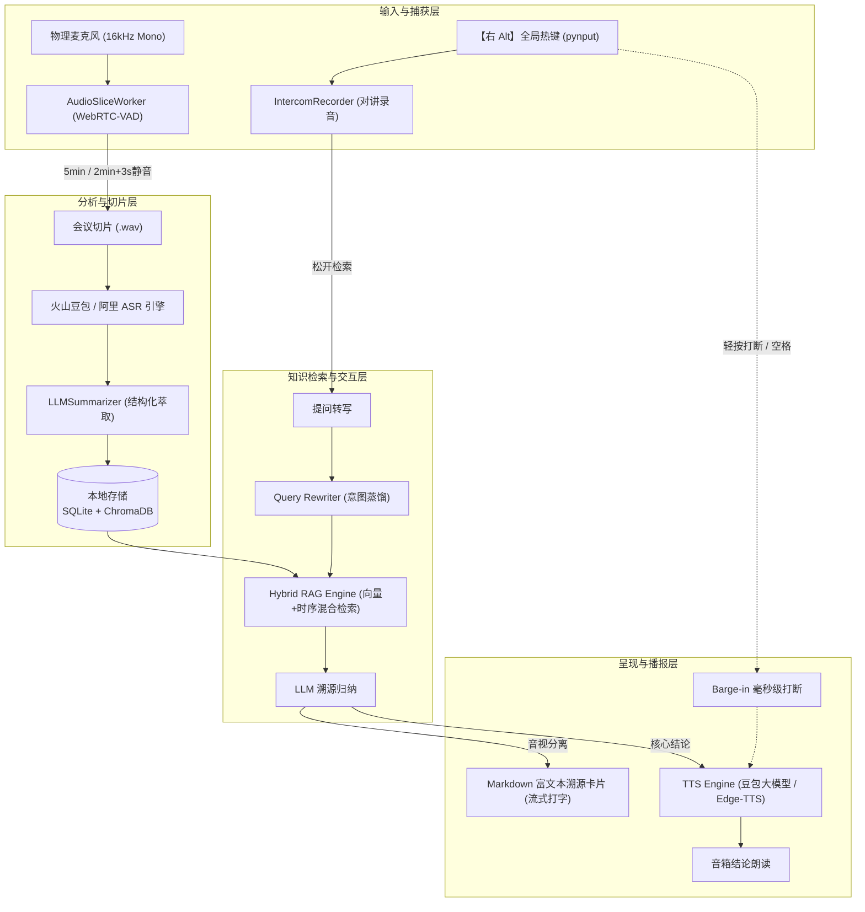

# DeskEcho (桌面回响) 🎙️

> **企业常驻会议记忆与对讲助理 (Windows Native AI Assistant)**  
> 全天候自动捕捉线下与线上会议，毫秒级【右 Alt】对讲溯源，沉淀不可磨灭的企业私域知识资产。

[](https://www.python.org/)
[](https://riverbankcomputing.com/software/pyqt/)
[](https://www.volcengine.com/)
[](https://api.deepseek.com/)
[](LICENSE)
[](https://www.microsoft.com/windows)

---

## 💡 为什么需要 DeskEcho？

在日常高频的线下协同、站会与桌面讨论中，绝大多数关键决策、口头交代和临时排期**说完即散**，造成严重的信息不对称与资产流失：
* **传统会议录音笔**：需要手动开关、会后手动导出长达数小时的大音频，不仅无人查听，更无法被精准检索；
* **在线会议纪要插件**：仅局限于特定视频会议软件，无法捕获真实的桌面旁听、走廊沟通与临时讨论；
* **云端公有工具**：敏感业务讨论与商业机密直传公网，存在巨大的合规与数据安全风险。

**DeskEcho 专为 Windows 桌面办公常驻而生**。它静默驻留在系统托盘，利用底层 VAD 算法自动监听并智能切片，自动完成语音转写与结构化知识提取，沉淀到本地向量与时序数据库。任何时候只需长按键盘**【右 Alt】**，即可像对讲机一样随口发问，瞬间获得带精准时间轴、发言人与原文引证的结构化解答！

---

## ✨ 核心特性

### 1. 🎙️ 24/7 环境自适应静默监听与智能切片 (Audio Worker)
* **动态 VAD 边缘切分**：基于 WebRTC-VAD 单声道 16000Hz 采集，支持“满 5 分钟”或“满 2 分钟且连续 3 秒静音”自动截断入库；
* **低功耗流式转写**：无缝对接**火山引擎豆包语音大模型 2.0** 与 **阿里 DashScope**，高精度过滤语气词与环境杂音；
* **结构化自动萃取**：大模型自动提炼四要素：`核心议题 (Topic)`、`决策与结论 (Key Decisions)`、`待办事项 (Action Items)`、`事实备忘 (Key Facts)`。

### 2. ⚡ 笔记本物理单键【右 Alt】对讲与零延迟即时响应 (Push-to-Talk)
* **免 Fn 极简交互**：专为现代笔记本键盘深度调优，抛弃别扭的 `Fn + F8` 组合，右手大拇指自然落在空格右侧【右 Alt】，**按住即收音，松开即检索**；
* **毫秒级 Zero-Latency ACK**：松手瞬间 0ms 即刻播报预置音效“稍等，正在检索”，彻底消除网络检索等待焦虑；
* **误触智能过滤**：点按时长小于 0.5 秒或说话未开口时，系统自动识别并平滑复位，绝不产生冗余问答卡片。

### 3. 🔇 毫秒级全双工打断 (Barge-in) 与声学隔离
* **即时静音打断**：在语音播报结论过程中，随时轻点【右 Alt】、按空格键或点击界面 `[🔇 打断播报]` 按钮，即可瞬间阻断声音；
* **彻底杜绝声学自激串扰**：在对讲发问及音箱朗读答案期间，背景会议录音自动进入保护屏蔽模式，**提问内容与音箱喇叭声绝不泄露录入到会议切片中**。

### 4. 🧠 混合检索大模型增强 (Hybrid RAG & Query Rewriting)
* **意图对齐蒸馏 (Query Rewriting)**：将口语化提问（如“老王刚才说的排期”）自动补全时间背景、人名别名与代词指代；
* **双路协同索引**：ChromaDB 向量相似度检索 + SQLite 全文字段与时间范围协同过滤；
* **音视分离呈现**：TTS 语音极简朗读核心结论（15秒内抓取重点），屏幕卡片展示详尽推导过程与时间切片依据。

### 5. 👥 真实企业组织通讯录与动态会议履历卡片
* **真实团队架构对齐**：完整收拢管理层、产品研发、语音交互、全栈开发、行政教研与视觉设计等 9 位团队成员；
* **点击展开动态履历**：卡片支持点击向下展开，实时从历史会议切片库中反查提取该成员的最近议题、**关键决策主导（✅）**、**落实待办事项（📌）** 与 **现场讨论原声（🎙️）**；
* **音似与误读自动纠错**：知识库内置语音别名与同音误读映射表，保障语音交互时对人名、称谓的高命中率识别。

### 6. 🧹 会议记忆库“或许没用”AI 研判与智能清理专区
* **AI 价值分级诊断**：系统自动研判并标记开场寒暄、测试试音、会议暂停等待或缺乏实质决议/待办推进的次要级切片；
* **正式资产防误删保护**：正式高价值会议切片严格受保护，不提供任何删除操作，杜绝误操作破坏资产沉淀；
* **选择性删除与一键清空**：在“或许没用”专属菜单中，提供单段切片选择性删除与 `💥 一键清空所有次要切片`，同步清除 SQLite 与 ChromaDB 向量缓存。

### 7. 🎨 Alma Obsidian 黑曜石现代美学界面与极简侧边栏
* **沉浸式黑曜石底座 (`#0A0C10`)**：基于 Alma 设计语言打造，辅以美好智能品牌三色动态渐变频谱 (`#13459D` 靛青 -> `#26B0E4` 海青 -> `#8AC657` 鹦鹉绿)；
* **极简化常驻边栏**：左侧边栏精简常驻“⚡ 对讲与检索”，并在下方常驻“📜 会话历史”折叠菜单，支持点击向下展开、历史问答回溯，配备快捷小 `+`（气泡提示“新会话”）；
* **右下角小齿轮设置入口 (`⚙️`)**：将企业通讯录、会议切片库与引擎状态收纳至边栏右下角小齿轮中，随时调出并支持分段切换；
* **全宽沉浸式解答**：去除主界面冗余的右侧常驻流，知识溯源解答区域独占全宽，提供绝佳的阅读与溯源引用体验。

---

## 🏗️ 系统架构



---

## 🚀 快速上手

### 1. 环境准备
- 操作系统：Windows 10 / 11 (64-bit)
- Python 版本：Python 3.11（强烈推荐通过 Anaconda / Miniconda 安装）

### 2. 克隆项目与安装依赖
```bash
git clone https://github.com/bababoyibibilabu/DeskEcho.git
cd DeskEcho

# 创建并激活 conda 独立环境
conda create -n deskecho python=3.11 -y
conda activate deskecho

# 安装项目依赖
pip install -r requirements.txt
```

### 3. 配置环境变量
复制环境配置模板：
```bash
copy .env.example .env
```
用编辑器打开 `.env` 并填写对应 API 密钥：
```ini
# 大模型 API (兼容 OpenAI 协议，支持 DeepSeek / 通义千问等)
OPENAI_API_KEY=your_llm_api_key
OPENAI_BASE_URL=https://api.deepseek.com/v1
LLM_MODEL=deepseek-chat

# 语音识别 (推荐火山引擎豆包流式 ASR 2.0)
ASR_PROVIDER=volcengine
VOLC_APPID=your_volc_appid
VOLC_ACCESS_TOKEN=your_volc_access_token

# 对讲热键与数据目录 (默认 Alt_R 免按 Fn)
INTERCOM_KEY=Alt_R
DATA_DIR=./omni_data
ENABLE_TTS=true
TTS_PROVIDER=edge-tts
```

### 4. 启动运行
直接双击运行工程根目录下的 `run.bat`，或在命令行执行：
```bash
python main.py
```

---

## ⌨️ 快捷操作指引

| 操作动作 | 交互效果 | 场景说明 |
| :--- | :--- | :--- |
| **按住【右 Alt】说话** | 激活顶部红色收音长条，声波实时律动 | 随时对讲提问，自动暂停背景会议收音 |
| **松开【右 Alt】** | 0ms 播放“稍等，正在检索”，开始流式回答 | 自动将语音转写并同步至顶部搜索框 |
| **播放中点按【右 Alt】或【空格】** | 毫秒级静音掐断 TTS 语音播报 | 全双工打断，保留屏幕文字解答供阅读 |
| **点击边栏【会话历史】** | 向下展开/收起历史对话列表 | 随时回溯历史多轮上下文，支持右键删除会话 |
| **点击会话历史右侧【+】** | 开启全新的对话会话 | 快速重置多轮上下文（带“新会话”气泡提示） |
| **点击边栏右下角【⚙️】** | 呼出设置中心分段导航 | 查看企业通讯录、切片记忆库及引擎通信监控 |
| **进入切片库【或许没用】** | 审查 AI 研判的低价值切片 | 选择性单段删除或一键清空次要碎片，保护正式资产 |
| **点击右上角【X】** | 静默最小化至系统托盘 | 保持后台 24 小时会议录音守护不中断 |
| **在输入框按【Enter】** | 触发文字知识库检索 | 线下环境不便说话时使用纯文本检索 |

---

## 📂 项目结构

```text
DeskEcho/
├── core/                        # 核心引擎层
│   ├── asr_client.py            # 火山引擎 / 阿里多引擎 ASR 客户端
│   ├── audio_recorder.py        # WebRTC-VAD 背景切片与对讲专用录音机
│   ├── entity_dict.py           # 企业组织实体与知识库定义
│   ├── knowledge_engine.py      # SQLite 时序切片持久化存储
│   ├── llm_summarizer.py        # 结构化会议纪要自动萃取
│   ├── query_rewriter.py        # 口语意图蒸馏与重写引擎
│   ├── rag_engine.py            # ChromaDB + SQLite 混合检索管道
│   └── tts_engine.py            # 火山豆包大模型 / Edge-TTS 自适应播报
├── ui/                          # 原生 PyQt6 界面层
│   ├── audio_visualizer.py      # Alma 三色音频频谱动画组件
│   ├── intercom_hotkey.py       # pynput 全局底层热键监听器
│   ├── main_window.py           # 控制台主界面与知识解答区
│   └── tray_icon.py             # Windows 系统托盘守护
├── config.py                    # 全局动态配置解析
├── main.py                      # 应用程序主入口
├── requirements.txt             # Python 依赖清单
├── run.bat                      # 一键运行批处理脚本
├── run_background.bat           # 后台无黑框启动脚本
├── .env.example                 # 环境变量模板文件 (脱敏)
├── .gitignore                   # Git 忽略配置
├── LICENSE                      # PolyForm 非商用开源协议
└── README.md                    # 项目官方文档
```

---

## 🔒 数据安全与隐私合规

1. **音频数据物理本地化**：所有会议切片 `.wav`、SQLite 关系库 `records.db` 以及 ChromaDB 向量缓存完全存储在用户指定的本地盘符（如 `D:\DeskEcho_Data`），未授权绝不出网；
2. **纯粹单向向量入库**：仅在提取关键结构化信息时调用大模型摘要接口，不保存任何公网用户画像；
3. **敏感凭证严格隔离**：代码仓库绝不上传任何凭证私钥，请妥善保管本地 `.env` 文件。

---

## 📄 开源许可证 (License)

本项目采用 **[PolyForm Noncommercial License 1.0.0](LICENSE)** 协议开源。
- 允许个人学习、学术研究、非商业性测试与内部技术评估；
- **未经官方书面商业授权，严禁将本项目源码、派生版本或打包制品用于商业化产品、SaaS 售卖或商业盈利运营**。
- 如需商业合作或商业授权，请通过 GitHub Issue 联系作者。
